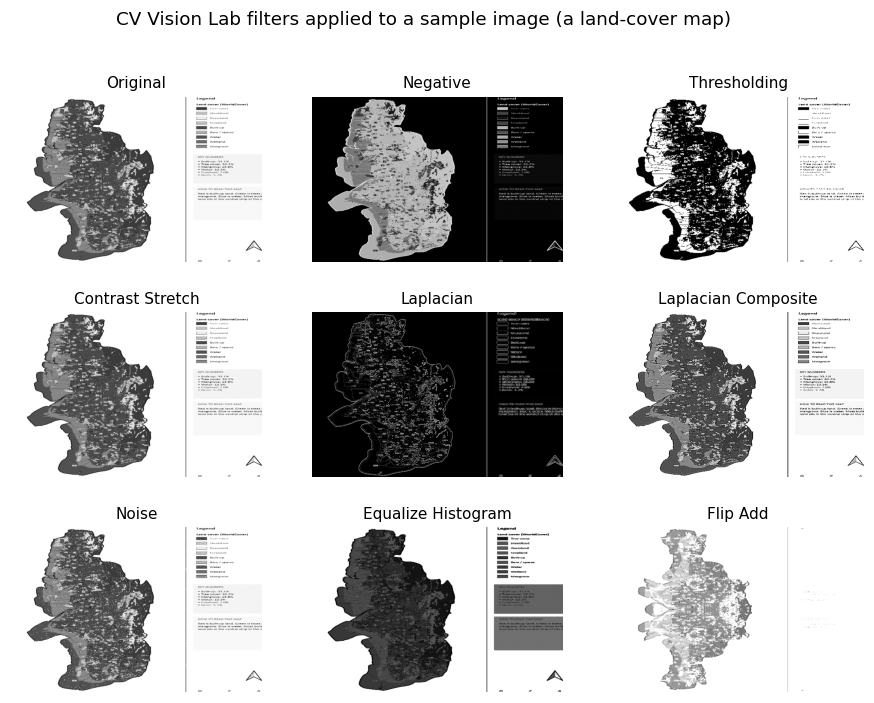

# OpenCV Vision Lab

Real-time computer-vision programs built on a webcam feed: a filter lab with a GUI, a hand-gesture mouse, a motion detector and live edge detection.



## What's inside

| Folder | What it does |
|---|---|
| `cv_vision_lab/` | **CV Vision Lab**, a CustomTkinter desktop app. It shows the raw webcam feed next to a processed feed. You pick the camera and one of 9 filters, and a Capture button saves the processed frame. Filters: Original, Negative, Thresholding, Contrast Stretch, Laplacian, Laplacian Composite, Noise, Histogram Equalization, Flip Add. |
| `hand_gesture_mouse/` | Control the Windows cursor with your hand. MediaPipe tracks hand landmarks and the index fingertip drives the pointer, smoothed over the last few frames. Pinch thumb and middle finger for a left click, or hold the pinch to drag. Pinch thumb and ring finger for a right click. `hand_tracker_v1.py` is the first prototype, `hand_tracker_final.py` adds drag and click cooldowns, and `virtual_mouse_app.py` is a smaller variant. |
| `motion_detection/` | Frame differencing (`absdiff`, threshold, contours) on a video or webcam. It draws boxes around moving regions and flags "Motion Detected" above a pixel-count threshold. |
| `live_filters/` | `live_edge_detection.py` runs Sobel, Prewitt and Laplacian kernels on live video. `video_filters.py` applies negative, thresholding, contrast stretching and Laplacian filters to the webcam. |

The same kernels, plus a pixel-loop sharpening filter, are in [Digital-Image-Processing](https://github.com/Shaikh-Mohammad-Hasnat/Digital-Image-Processing). The webcam to ASCII art program lives in [ASCII-Video-Filters](https://github.com/Shaikh-Mohammad-Hasnat/ASCII-Video-Filters).

## Run it

```bash
pip install opencv-python numpy pillow customtkinter mediapipe pyautogui
python cv_vision_lab/cv_vision_lab.py
python hand_gesture_mouse/hand_tracker_final.py
```

Notes:
- The hand-mouse scripts use MediaPipe's `mp.solutions.hands` API. They may need an older `mediapipe` release on newer Python versions.
- `motion_detection.py` reads `CCTVfootage.mp4` from the working directory. Put your own clip there, or change the path to `0` for the webcam.
- Pinch thresholds and cursor scaling are tuned for my webcam and screen. Adjust the constants at the top of the file.

## Tech
Python, OpenCV, NumPy, MediaPipe, PyAutoGUI, CustomTkinter, Pillow.

## Author
Shaikh Mohammad Hasnat, [GitHub](https://github.com/Shaikh-Mohammad-Hasnat), [LinkedIn](https://www.linkedin.com/in/shaikh-mohammad-hasnat-698a08335)
